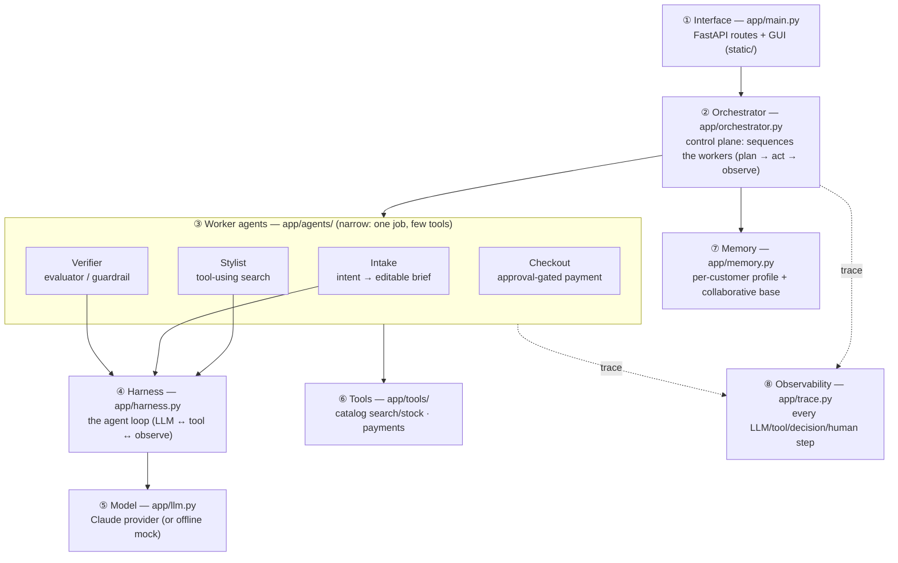

# CloudShop — Agentic AI Architecture

CloudShop is an **AI wrapper over a shopping backend**: a user-facing layer, powered by an LLM,
that runs *tool-using agents* to turn a plain-language request into a checked, approval-gated
purchase. It is organised as a layered agentic system following the **orchestrator–workers** pattern
(a coordinator delegating to narrow worker agents), which the references below identify as the
standard shape for this kind of application.

## Layers

| # | Layer | Module(s) | Responsibility |
|---|---|---|---|
| ① | **Interface** | `app/main.py`, `static/` | HTTP routes + GUI. Thin: validate, delegate to the orchestrator, serve the UI. |
| ② | **Orchestrator** (control plane) | `app/orchestrator.py` | One `Orchestrator` per session. Owns session state; sequences the workers (Intake → Stylist → Verifier → Checkout) and the memory layer. Never calls an LLM itself. |
| ③ | **Worker agents** | `app/agents/{intake,stylist,verifier,checkout}.py` | Narrow specialists — one job, a small tool set, a short prompt. The **Verifier** is an *evaluator/guardrail* over the Stylist's output. |
| ④ | **Harness** (runtime) | `app/harness.py` | The agentic loop that turns a model into a tool-using agent: LLM call → tool calls → observations → repeat until the agent submits (or a turn limit). Owned by us so every step is traced. |
| ⑤ | **Model** | `app/llm.py` | Single point of model access (Claude via the Anthropic SDK; a deterministic offline mock when no key is set). |
| ⑥ | **Tools** | `app/tools/` | The functions agents call: `catalog` (search / get / check_stock / reserve) and `payments` (the MockPay provider). The data access behind them lives here too. |
| ⑦ | **Memory** | `app/memory.py` | A returning customer's preference profile derived from history + a 250-shopper base for collaborative filtering. Pre-fills the brief and biases the Stylist. |
| ⑧ | **Observability** | `app/trace.py` | Every LLM call, tool call, agent decision and human action is recorded and surfaced in the UI's *Agent activity* drawer. |

`app/models.py` is the shared **contract** (pydantic schemas) that every layer passes; `app/config.py`
holds configuration. The **data pipeline** (`pipeline/`, bronze → silver → gold) builds the catalogue
the Tools layer serves — swappable for a real retailer's feed without touching the agents.

## Request lifecycle (plan → act → observe)

1. **Interface** receives an HTTP request and calls the session's **Orchestrator**.
2. The **Orchestrator** invokes the right **worker**: Intake builds the brief; Stylist searches;
   Verifier checks every pick; Checkout plans and (after approval) pays.
3. A tool-using worker (Stylist) runs inside the **Harness**, which calls the **Model** and executes
   **Tools**, looping until it submits — the *plan-act-observe* loop.
4. The **Memory** layer personalises the brief and ranking when a customer is signed in.
5. Every step is written to **Observability** and returned in the session state the UI renders.

## Design principles (and where they come from)

- **Orchestrator–workers with narrow workers.** A coordinator delegates to agents that each have one
  job, a small tool set and a short prompt — Anthropic's guidance for effective agents. CloudShop's
  four agents are exactly this.
- **Evaluator / guardrail.** The Verifier is a separate agent that checks the Stylist's output against
  hard constraints and grounds its claims — the *evaluator-optimizer* pattern, and the "guardrails"
  layer of the reference stack. The proposer is never the checker.
- **Human oversight.** Payment is gated behind an explicit, hash-bound approval; the agent plans and
  stops. Memory is shown to the shopper, who can edit or forget it.
- **Observability as a first-class layer.** When control flow is partly decided by a model, a trace of
  what ran (and why) matters as much as the code — so every step is recorded and user-inspectable.
- **Source-agnostic agents.** The Tools layer serves one normalised product shape from the data
  pipeline, so a real retailer feed could replace the synthetic Marketplace without changing any agent.

## References

- Anthropic — *Building Effective Agents* (orchestrator–workers, evaluator-optimizer, "keep workers
  narrow", start simple): <https://www.anthropic.com/research/building-effective-agents>
- *From Prompt-Response to Goal-Directed Systems: The Evolution of Agentic AI Software Architecture*,
  arXiv (layered agent core / control / memory / tooling; runtime observability): <https://arxiv.org/abs/2602.10479>
- DesignGurus — *How to Design an AI Agent* (seven-layer stack: interface, orchestrator, LLM, tools,
  memory, guardrails, observability): <https://www.designgurus.io/blog/design-an-ai-agent>
- *AI Assistant Architecture: LLM, Memory, Tools, Routing, Observability* (one orchestrator, one
  durable memory path, one trace per request): <https://glukhov.org/ai-systems/architecture/ai-assistant-architecture/>
