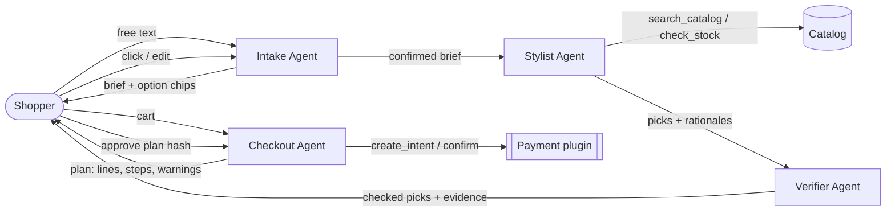
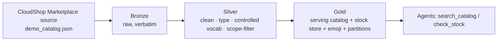

# Design rationale

## Why clothes shopping needs AI, and why it needs human-centred AI

Shopping for clothes means juggling hard constraints (size, budget, materials) with soft,
hard-to-say preferences ("something for a summer wedding that isn't too formal"). Filters on
a store's website capture the first kind and ignore the second. An LLM agent captures both,
but it adds three new risks: it may **misread** the shopper, **misstate** facts about a
product, and **spend money** the shopper didn't mean to spend. Each of the three ideas
targets one of these risks.

## Architecture

Why separate agents? Each one has a single job and a narrow tool set. In particular, **the
agent that proposes products is never the agent that checks them**, and **no LLM ever holds
the payment tool**.

## Data architecture (Medallion: bronze → silver → gold)

The catalog the agents query is not hand-maintained JSON; it is the **gold** output of a
three-layer data pipeline (`pipeline/`, run by `main.py`), the same bronze → silver → gold
layering used in the MLE pipeline. This keeps raw data, cleaning rules and the serving shape
separate. The source today is the synthetic CloudShop Marketplace; in production the *same*
pipeline would clean a real retailer's feed into the identical gold shape, so the agents never
change (see [Data source](#data-source)).

- **Bronze** (`pipeline/bronze.py`): raw ingestion, copied verbatim with a manifest
  (`data/datamart/bronze/`).
- **Silver** (`pipeline/silver.py`, `pipeline/schema.py`, `pipeline/normalize.py`): coerce types;
  keep only in-vocabulary colours, materials, styles and occasions (e.g. an unknown occasion `golf`
  is stripped and logged); drop children's items and non-apparel accessories; validate category,
  section and price via a pydantic `Product` model; de-duplicate. Every drop and strip is recorded
  in `silver/_report.json` — the pipeline is auditable.
- **Gold** (`pipeline/gold.py`): the query-ready **serving catalog** (every silver field plus
  derived `department`, `emoji`, `sizes_in_stock`, `in_stock`, `price_tier`), a per-size **stock
  store**, partitioned views by department × section, and the standalone catalogue viewer. The app
  reads gold and never the raw source.

Why it helps the three ideas: the Verifier (Idea 2) can trust that every product already conforms
to one schema and one vocabulary, so its checks compare like with like; and because a real retailer
feed would be cleaned into this same shape, the agents are source-agnostic.

---

## Idea 1: Intent expression through an editable brief (Week 1)

**What.** The Intake Agent turns free text into a structured `ShoppingBrief`. The GUI shows
the brief as a form. Each field is tagged *you said*, *AI inferred* or *you edited*. Fields
the AI inferred get an amber border inviting a check. For gaps that would change the results,
the agent offers 2–4 clickable options ("What size on top? S · M · L · XL") plus a free-text
box.

**Why it helps.**
- Shoppers rarely give a complete spec up front. Clickable options are cheaper than writing
  a better prompt, and they show the answer space.
- The provenance colours make the AI's assumptions visible. A wrong inference, like "wedding
  ⇒ elegant", can be corrected before it shapes every later recommendation.
- The brief is a shared, inspectable representation of intent. Every later agent reads the
  brief rather than the raw chat, so an edit propagates everywhere.

**Design rules** (in the prompt and in code): never invent a size or budget, ask at most 3
questions, and never ask about a field that is already filled. A clicked option is applied
deterministically, with no LLM round trip.

**Variations to discuss in the report.** Chips vs. open questions vs. no clarification at
all; asking up front vs. just in time (only when the Stylist hits ambiguity); showing
confidence scores instead of three provenance categories.

## Idea 2: Verifiable recommendations (Week 2)

**What.** Every Stylist pick goes through the Verifier before the shopper sees it:
1. **Hard-constraint checks in plain code** (category, section, budget, size in stock,
   avoided colours, avoided materials, plus **returns/final-sale** and a **price-drop** note from
   the richer product fields). Each check carries its evidence, e.g. "$129.00 vs total budget
   $150.00", "Size M: out of stock", or "On sale: S$89, down 20% from S$112".
2. **Claim grounding**: the Stylist's rationale is split into atomic claims, and each claim
   is checked against the raw product record (Claude as critic; a keyword heuristic offline).
   Grounding now covers the richer attributes too — a "pure linen" claim is checked against
   `fabric_composition`, "machine washable" against `care`, "made in Italy" against `origin`, and
   "on sale" against `original_price` — so precise-sounding but false claims are caught.

The GUI shows a verdict badge on each card, an expandable checklist, and a Verify tab with
the full item × check matrix. Picks that fail are hidden by default but one click reveals
them, so the system never silently drops anything.

**Why it helps.** Shoppers can't easily check an LLM's "this linen dress is perfect for your
budget" against the product page. Moving verification into the interface, with the evidence
next to the claim, lowers that cost. Hard constraints are checked by code because they have
exact answers and errors there cost real money.

**Variations.** An LLM critic vs. code-only checks; showing evidence inline vs. on demand;
auto-hiding failing items vs. showing everything with warnings.

## Idea 3: Approval-gated checkout (Week 4)

**What.** The Checkout Agent builds a **plan**: line items, totals, the exact steps it will
take ("Reserve stock → create payment intent → charge Visa ••4242 → place order; if the
charge fails, release stock and charge nothing"), and warnings (verifier issues in the cart,
over budget, low stock). Then it stops.
- **Approval is bound to a hash of the plan.** If anything changes afterwards (cart, price,
  payment method), the approval is void and a fresh plan must be reviewed. An approval cannot
  be replayed.
- **Spending cap as a standing mandate.** Going over it needs a second explicit confirmation.
- The shopper can **Approve**, **Reject** or **Edit cart** (back to Discover).

**Why it helps.** Payment is irreversible and high stakes, which is exactly where human
oversight belongs. Showing the plan before acting turns "trust the agent" into "check a short
list". Binding approval to a hash closes the gap where an agent changes the order after the
human agreed to it.

**Variations.** Per-purchase approval vs. a pre-authorised mandate ("auto-buy under $50");
plan detail level; where the confirmation step sits.

### Hardened payment gateway — the multi-gate, human-in-the-loop flow

Payment is the one place we deliberately refuse to let the AI act on its own. The simple plan-then-
approve flow above is extended into a **Visa/Mastercard-rails gateway** (`app/tools/payments/card_network.py`)
driving a **five-gate state machine** (`app/agents/secure_checkout.py`). The gateway models what a
bank-partnered PSP actually does — **authorize (hold) → 3-D Secure OTP/2FA → capture (settle) → void** —
so swapping in a real acquirer (Adyen, Stripe) is a thin translation. Each gate is grounded in Week 2
(appropriate reliance = *workflow design*, W2-58):

| Gate | Human action | Week-2 principle |
|---|---|---|
| 1. Cart review | Confirm items, sizes, totals | **Approval before consequential action** (Abridge workflow gating, W2-59) |
| 2. Payment method | Confirm which card will be charged | **Verification effort** — one cheap, specific check (W2-46/48) |
| 3. Combined review | Re-confirm cart **+** card **+** amount *together* | **Cognitive forcing function** — breaks AI anchoring, forces a fresh look (Buçinca, W2-62) |
| 4. 3-D Secure OTP / 2FA | Enter the code sent to the phone | **Deferral / allocate** to the human on a high-stakes action (W2-45/55/61); the second factor is *structurally* human |
| 5. Final approver | "Pay now" captures the held funds | **Approval before action**, again, at the irreversible step (W2-59) |

**Why this is the strongest form of the idea.** It operationalises the course's reliance matrix (W2-15):
every gate is an opportunity for *correct self-reliance* — the human can reject or correct the agent's
proposal before anything irreversible happens. The guardrails that hold across the machine:

- **The agent can prepare, but cannot pay.** At gate 4 the agent fills in the order details, yet the OTP
  (something-you-have) is one the agent cannot produce — so it can never self-authorize a charge. This is
  the "no privileged action taken by the agent alone" rule applied to money.
- **Hash-bound gates.** Each confirmation binds a hash of exactly what was shown; if the cart or card
  changes afterwards the downstream approvals are void and the flow resets (no bait-and-switch).
- **Authorize ≠ capture.** Authorization only places a hold; money moves only at the final human approval,
  and capture is **idempotent** (single-use key) so a replayed approval never double-charges.
- **Spending cap** stays a standing mandate; exceeding it needs an explicit override at gate 3.
- **Honest audit trail.** Every gate event is logged (observability — "log the trajectory").

Evaluated by nine guardrail tests (`tests/test_secure_checkout.py`): no charge before all gates, cannot
skip to finalize, OTP required, three wrong OTPs void the hold, cart-change resets the binding, cap needs
override, declined card rejected at authorization, and no replay after capture.

## Idea 4: Agent memory / personalisation (Week 4) · `app/memory.py`

**What.** A returning customer has a profile *derived from their choice history*: the colours,
styles, materials and categories of what they **bought or liked** (ranked up) and **rejected**
(filtered out), plus their sizes. Signing in ("Shopping as…") pre-fills the brief from this memory —
every remembered field is tagged **remembered** (a fourth provenance colour) and is editable — and
biases the Stylist, which then explains the link ("*in navy, a colour you've chosen before*").

**Mechanism (not fuzzy).** Preferences are concrete, evidence-backed attributes aggregated from real
past choices, not a vector similarity. `profile()` counts attributes over the kept vs. rejected
history; likes = stated prefs ∪ attributes of kept items; **avoids need a strong signal** — a stated
dislike, or an attribute in ≥2 rejected items and never in a kept one — so one incidental colour is
not banned. Adding an item to the cart writes back to the history, and the panel updates.

**User-facing (the Week-4 human component).** A **"What we remember about you"** panel shows exactly
what is stored (likes, avoids, how many past choices it is based on); the shopper can edit any
pre-filled brief field or **"Forget & shop as guest"** — consent and oversight over the memory, not
an opaque profile.

**Collaborative filtering ("shoppers like you also chose…").** Beyond the signed-in shopper's own
history, the system has a **population of ~250 synthetic customers** (`data/source/customers.json`: 8
featured demo personas + ~240 varied population shoppers, each with a taste profile and a choice
history). `neighbors()` finds the shoppers whose taste is most similar (Jaccard over shared
colours / styles / materials / categories + section); `collaborative_suggestions()` collects the
products those look-alikes bought or liked. In the Stylist, **among the items that already fit the
brief**, the ones chosen by similar shoppers are ranked first and labelled (*"Popular with N shoppers
who share your taste"*). It only ever promotes brief-matching items — it never overrides a hard
constraint. (Item overlap is naturally sparse with 250 shoppers over 1,201 products, so counts are
small; a production system would have far more behavioural data.)

**Why it helps.** It reduces the thinking a shopper repeats every visit (re-entering sizes, budget,
tastes), turns their history into a *definite* filter+rank signal, and lets a look-alike population
surface options they'd like but didn't ask for — while keeping the shopper in control of what is
remembered.

**Note on grading.** The three graded ideas are Intent (W1), Verification (W2) and Oversight (W4);
memory is a *fourth* implemented idea (also W4). It can be swapped in as one of the three if preferred —
it is strongly user-facing, which the course rewards.

---

## Possible extensions

- **Persisted memory:** customer profiles currently live in memory per process; persist writes to a
  store so history survives restarts.
- **Real payment plugin:** a Stripe test-mode adapter implementing `PaymentProvider`
  (the MockPay shape already mirrors PaymentIntents).
- **Real catalog:** replace the CloudShop Marketplace source with a licensed retailer feed (a new
  bronze ingest in `pipeline/`); the agents are unchanged (see [Data source](#data-source)).

---

## Data source: the CloudShop Marketplace {#data-source}

CloudShop is positioned as an **AI/multi-agent wrapper that sits on top of a shopping backend** — the
kind of layer a major online retailer could put over its own catalogue. For this prototype that
backend is the **CloudShop Marketplace**: a single synthetic storefront of **1,201 products** across
20 categories and 12 (fictional) retailers, built by the data pipeline.

It is deliberately a **licence-free replica**, not scraped data:

- **No real store names or copied content**, so it can be published and submitted freely.
- Each product shows a **category emoji** (derived in gold) instead of a copyrighted product photo.
- Rich attributes the Verifier grounds claims against — `fabric_composition`, `care`, `origin`,
  `rating`, `returnable`, `original_price`, plus store-style `store` / `badges` / `free_shipping` /
  `colorways` / `silhouette` / `sleeve_length` / `neckline` / `pattern` — so a false "pure linen /
  machine-washable / made in Italy / on sale" claim is caught, not just colour and price.
- A backend catalogue viewer lists the whole inventory with ~20 filters and sliders, both live at
  `/admin` and as a standalone `data/datamart/gold/catalog_viewer.html` (see the README).

**How it maps to the real world.** The Marketplace is what a real store's product feed would replace
once licensing, API access and brand agreements are signed — something this course project cannot
obtain, so the replica stands in for it. Because the pipeline cleans any source into one normalised
gold shape, swapping in a real feed would touch only `pipeline/` (a new bronze ingest), not the four
agents or the UI. In that sense the prototype demonstrates exactly how the system would behave on real
data once permissions are in place.
